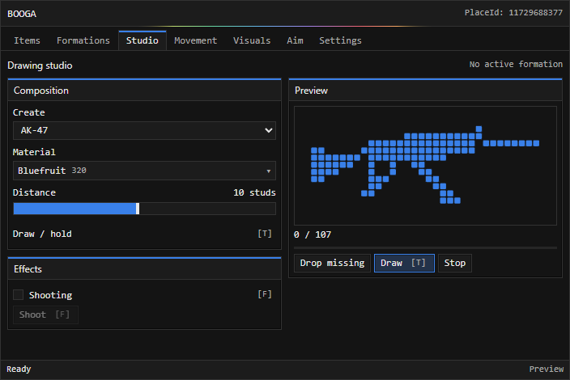

# Booga UI

A reusable Roblox **Luau** UI library built from the approved Booga design: compact horizontal tabs, two-column groupboxes, Code-font labels, blue accents, and minimal text.

The title shows the live `game.PlaceId`. A thin animated rainbow accent sits against the bottom of the title bar, centered at 54.6% of the window width and capped at 364 pixels. Checkboxes animate, the window fades/scales open and closed, and **RightShift** toggles it. The menu key is rebindable.



*Design reference captured from the approved browser draft. Native Roblox rendering has not yet been visually verified. The Luau bundles compile and the behavior tests pass; headless mocks do not establish pixel-perfect Roblox rendering.*

## Require in Roblox Studio

1. Import `dist/BoogaUI.rbxmx` into `ReplicatedStorage` as **BoogaUI**.
2. Require it from a **LocalScript**:

```lua
local UI = require(game.ReplicatedStorage:WaitForChild("BoogaUI"))
local window = UI:CreateWindow({ Name = "BOOGA" })
local tab = window:AddTab("Main")
local group = tab:AddGroupbox("Controls", "Left")

group:AddToggle("Shooting", {
    Text = "Shooting",
    Value = false,
    Callback = function(value) print(value) end,
})
```

You can also paste `dist/BoogaUI.lua` into a ModuleScript. With Rojo, sync `default.project.json` to install the modular source and demo.

## Standalone loader

In a client environment that explicitly supports HTTP and `loadstring`:

```lua
local UI = loadstring(game:HttpGet(
    "https://raw.githubusercontent.com/Proxo123/booga-ui/main/dist/BoogaUI.lua"
))()
```

This returns the library. It does not create a window or run Booga features. Standard Roblox LocalScripts should use the ModuleScript route above.

## Run the complete UI demo

For a small paste-and-run example covering toggles, sliders, material quantities, text input, buttons, colors, and Settings key rebinding, see [examples/Example.lua](examples/Example.lua). It loads the pinned v0.1.0 library; callbacks print values or change UI state.

Open `dist/BoogaDemo.rbxlx` in Roblox Studio and press **Play**. Alternatively, import the module and put `examples/Booga.client.luau` into a LocalScript under `StarterPlayerScripts`.

For supported standalone client environments, `dist/BoogaDemo.lua` embeds both the library and demo. The demo recreates Items, Formations, Studio, Movement, Visuals, Aim, and Settings. Material quantities are sample data. Its callbacks update UI state; it does not call gameplay remotes, move items, or enable game modifications.

## API

```lua
local window = UI:CreateWindow({
    Name = "BOOGA",
    Size = Vector2.new(704, 470),
    ToggleKey = Enum.KeyCode.RightShift,
    ReducedMotion = false,
    -- Parent defaults to the local player's PlayerGui.
    -- PlaceId defaults to game.PlaceId.
})

local page = window:AddTab("Studio")
local group = page:AddGroupbox("Composition", "Left")

local material = group:AddDropdown("Material", {
    Text = "Material",
    Options = {
        { Value = "Bluefruit", Label = "Bluefruit", Meta = 320 },
        { Value = "Wood", Label = "Wood", Meta = 180 },
    },
    Value = "Bluefruit",
    Callback = function(value) print(value) end,
})

group:AddSlider("Distance", {
    Text = "Distance", Min = 1, Max = 20, Value = 10,
    Step = 1, Suffix = "studs", Callback = function(value) print(value) end,
})

group:AddTextbox("Text", { Text = "Text", Value = "BOOGA", MaxLength = 32 })

group:AddKeybind("MenuKey", {
    Text = "Show / hide menu", Value = Enum.KeyCode.RightShift,
    Callback = function(key) window:SetToggleKey(key) end,
})

group:AddButton({ Text = "Draw", Primary = true, Callback = function() end })
group:AddButtons({ { Text = "Draw", Callback = function() end }, { Text = "Stop", Callback = function() end } })

local advanced = group:AddDisclosure("Advanced")
advanced:AddColorPicker("Color", { Text = "Color", Value = Color3.new(1, 1, 1) })

local preview = page:AddGroupbox("Preview", "Right"):AddPreview({
    Points = { Vector2.new(0, 0), Vector2.new(1, 0) }, Height = 148,
})
preview:SetCount(0, 2) -- Displays only "0 / 2".
preview:SetPoints({ Vector2.new(0, 0) })
preview:Recoil()
```

Controls expose `Get()`, `Set(value)`, `SetSilent(value)` / `RawSet(value)`, `SetCallback(fn)`, `SetEnabled(bool)`, and `SetVisible(bool)`. `Set` invokes the callback only on a changed value. `SetSilent` updates display/value without invoking the callback or scheduling a config save. Register IDs once and keep them stable across updates.

Dropdowns support `UpdateOptions(options)` while retaining a selected value that still exists. `Meta` is drawn smaller and grey, separately from the name. Color pickers open a six-digit hex input.

Buttons return `SetEnabled(bool)` and `SetText(text)`. A button's optional `Keybind = { Id, Value, Callback, Pressed, Released }` displays a rebindable inline key. Toggles also accept `Keybind`. Standalone keybinds accept `Pressed` / `Released`; typing in a TextBox does not trigger shortcuts. Left/right modifiers are distinct. Escape cancels key capture.

`page:AddSubTab(name)` returns an object with `AddGroupbox(name, side)` and `Select()`. This powers Players / Resources / Style in the demo. `page:SetTitle(text)` and `page:SetMode(text)` update the page header.

Window methods: `SelectTab(page)`, `SetVisible(bool)`, `SetToggleKey(key)`, `SetStatus(text)`, `GetConfig()`, `LoadConfig(table)`, `EncodeConfig()`, `DecodeConfig(json)`, and `Destroy()`.

## Persistence

The library uses an adapter so storage is not coupled to a specific executor or game:

```lua
window:EnablePersistence({
    Read = function() return savedJSON end,
    Write = function(json) savedJSON = json end,
})
```

Enable persistence **after** creating the controls. Writes coalesce to at most one per half-second when values change; `Destroy` flushes pending changes. Unknown IDs are ignored when loading. Enum key codes and colors round-trip through JSON.

Where `readfile` and `writefile` are available, `UI.FileStorage("BoogaUI/config.json")` supplies a file adapter. The demo automatically uses it when available; Studio otherwise keeps settings in the current session. Supply your own adapter for game persistence.

## Build and test

Only Python's standard library is needed to build:

```powershell
python tools/build.py
# Or on Windows:
.\build.ps1
```

Outputs:

- `dist/BoogaUI.lua`: self-contained library; returns the library table.
- `dist/BoogaUI.rbxmx`: importable ModuleScript.
- `dist/BoogaDemo.lua`: standalone demo with the library embedded.
- `dist/BoogaDemo.rbxlx`: Studio demo place.

Tests use the official [Luau CLI](https://github.com/luau-lang/luau/releases):

```powershell
python tools/test.py --luau path/to/luau --compiler path/to/luau-compile
```

The test runner builds both bundles, compiles them, runs pure value-model tests, and instantiates the complete demo in a headless Roblox API mock. It exercises modifiers, capture/cancel/rebind, rapid visibility toggles, config restoration, coalesced writes, dropdown cleanup, and idempotent destruction. CI also checks that committed build outputs remain reproducible.

## Source structure

`src/init.luau` is the entry point. `Window.luau` handles chrome, navigation, visibility, input, persistence, and lifetime. `Controls.luau` implements the controls and preview. `internal/` contains theme tokens, construction helpers, and pure value logic. `examples/` owns the Booga-specific layout and demo callbacks.

Visual references: [Linoria](https://github.com/violin-suzutsuki/LinoriaLib), [Obsidian](https://github.com/deividcomsono/Obsidian), and [Dear ImGui](https://github.com/ocornut/imgui). This is an original implementation of the user's approved layout; upstream library source is not bundled.
